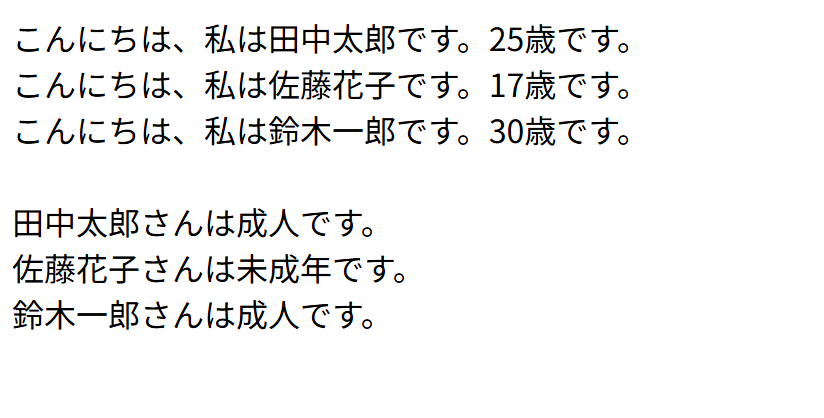

# php-oop-practice

## 概要
COACHTECH 教材 Tutorial 7-3「オブジェクト指向 ハンズオン演習」で作成した成果物です。
オブジェクト指向プログラミングの基礎の確認として、クラスの定義とインスタンスを作成して使用する方法を学びました。
クラス内でプロパティやコンストラクタ、メソッドを定義して外部から参照するようなプログラムを書きました。

## 使用技術
- PHP 8.2-fpr
- nginx

## 学んだこと
- クラスを定義してインスタンスを生成して使用する方法
- クラス内のプロパティとコンストラクタ、メソッドの定義の方法
- 「->」を用いてインスタンス内の特定のプロパティやメソッドを指定する方法

## 動作確認
1. php-practiceディレクトリ上でDocker composeによりnginxコンテナとphpコンテナを起動させてネットワークで連携
2. VSCode上でPHPファイルを編集して保存
3. ブラウザで「`http://localhost:8000/7-3-4_hands-on/practice/user.php`」のURLにアクセス
4. ブラウザ上で表示内容を確認
5. VSCodeでの編集を保存+ブラウザのリロードで編集内容を確認

## 詰まったポイントと解決方法
- それぞれのインスタンスのメソッドを実行する際にfor文を使用してまとめて実行しようとしたが、毎回異なる変数名($user1,$user2など)を用いて実行する必要があるため、実現が難しかった  
　┗各インスタンスを参照する変数(user1, user2)などを1つの配列にまとめ、その配列に対してforeach文を実行することで解決した

## 開発の工夫
- 複数のインスタンス参照のための変数について、自己紹介のメソッドをforeach文で実行することにより、さらにデータが増えた場合でも新たな変数を配列に追加していくことで、表示結果にも追加することができる
- 前回のハンズオンではコードを見るだけでも処理内容が明確なところまで冗長なコメントが多かったため、今回はよりコメントの挿入が適切であると判断したところにコメントを書くようにした

## 動作確認のスクリーンショット
